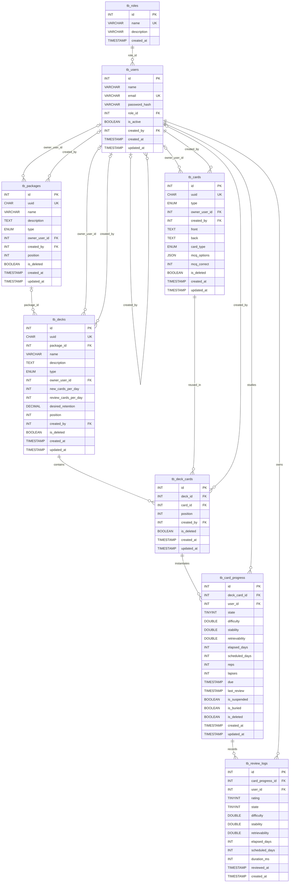
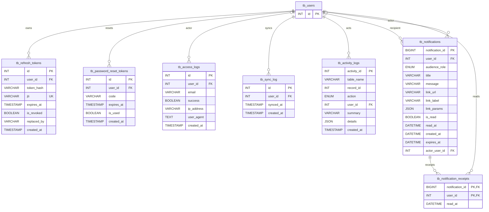

# MER da Base de Dados

## MER principal do dominio

## MER das tabelas de suporte

## Leitura do MER

- O eixo principal do dominio e `package -> deck -> deck_card -> card_progress -> review_log`.
- `tb_cards` e o conteudo reutilizavel que pode aparecer em varios decks.
- `tb_deck_cards` separa disponibilidade de catalogo do progresso do usuario.
- `tb_card_progress` so representa estudo iniciado.
- As tabelas de suporte vivem ao redor de `tb_users` para autenticacao, auditoria, notificacao e sync.